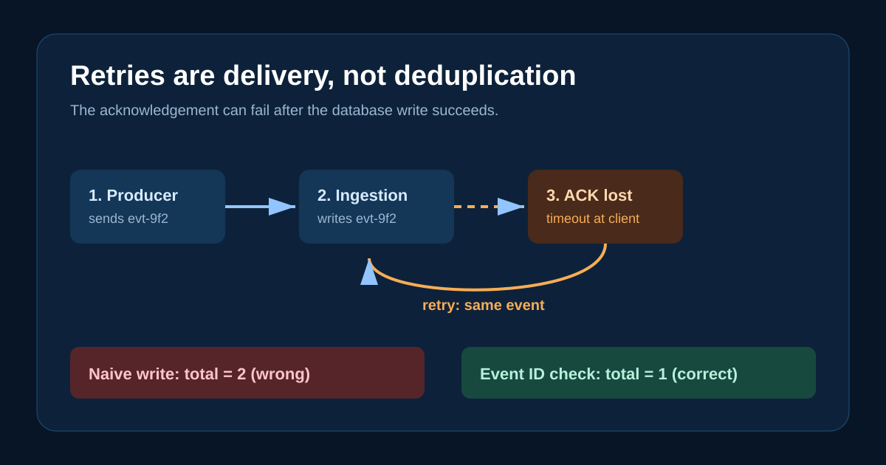

# Why retries alone create duplicate data in telemetry pipelines



Retries are necessary in telemetry pipelines. They are not enough to preserve data correctness.

Here is a normal failure path:

1. A producer sends `evt-9f2`.
2. The ingestion service persists it.
3. The acknowledgement is lost in transit.
4. The producer retries the same event.
5. A naive service persists it again.

Nothing has crashed. Both systems behaved reasonably. The resulting aggregate is still wrong.

This is why at-least-once delivery must be paired with idempotent consumption. The producer needs an event ID created before transmission, and the ingestion boundary needs to store that identity durably. A replay of `evt-9f2` should be observable, but it must not increase the metric, trace count, usage total, or billing total.

The difficult detail is the retention window. Deduplication data must live long enough to cover legitimate retries, offline buffers, and replay jobs. An in-memory set works for a demo, but it fails on replica changes and process restarts.

Run the demonstration:

```text
cd 01-retries-and-duplicates
```

The output shows the naive total become `2`, then the stable-ID path retain the correct total of `1`.

Source: https://github.com/ArpitUS/linkedin-engineering-demos/tree/master/01-retries-and-duplicates

Practical takeaway: generate one stable event ID before the first send, then make every repeat delivery of that ID a durable no-op.
