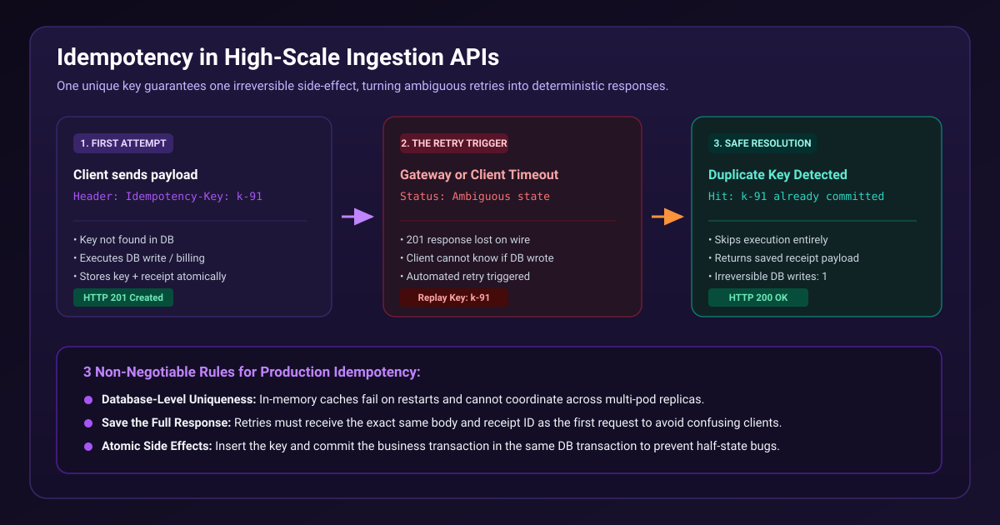

# Idempotency: the most overlooked requirement in high-scale ingestion APIs



An API can be fast, documented, and horizontally scalable while still duplicating customer data under a routine timeout.

Imagine a client submitting an ingestion batch. The server commits the batch and begins returning `201 Created`, but the connection drops before the client receives the response. The client retries because it cannot know whether the first attempt succeeded.

Without idempotency, the API performs the irreversible write twice.

The safe contract is simple: require an `Idempotency-Key` for each write. On the first request, atomically persist the key and the resulting receipt. On every request with the same tenant, request fingerprint, and key, return the original receipt instead of repeating the work.

Two details matter in production:

- Make uniqueness a database constraint in the same transaction as the side effect. A process-local map cannot coordinate replicas.
- Keep the original response. Returning a different result to a retry makes clients harder to reason about.

The included test sends 20 concurrent requests with one key. Exactly one irreversible write is recorded.

Run the demonstration:

```text
cd 02-idempotent-ingestion-api
```

Source: https://github.com/ArpitUS/linkedin-engineering-demos/tree/master/02-idempotent-ingestion-api

Practical takeaway: for every write endpoint, define the result of receiving the same request twice and enforce it with durable uniqueness.
