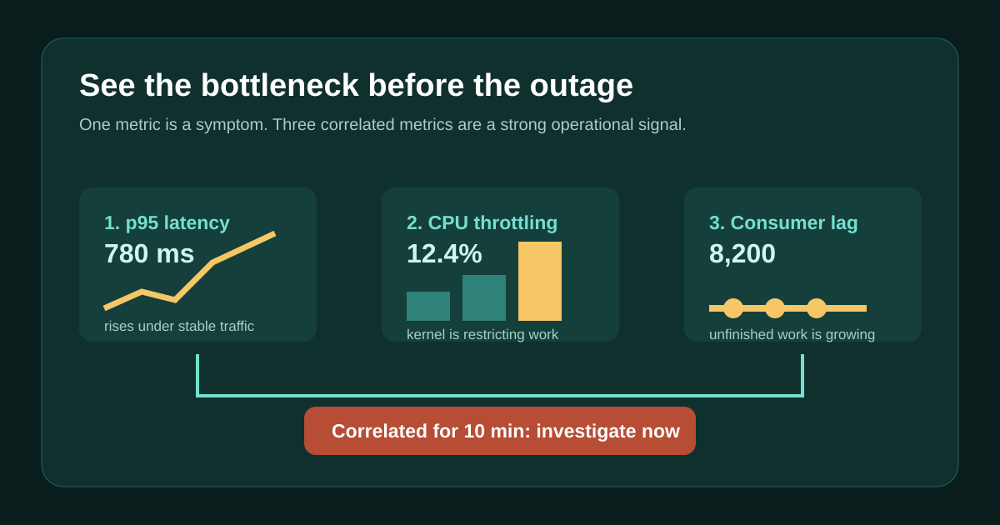

# Three Kubernetes signals that reveal a backend bottleneck before an outage



Most backend outages are visible before they become user-facing. The mistake is treating each signal independently.

The useful combination is:

1. **p95 latency rises while traffic is steady.** Capacity is being lost somewhere.
2. **CPU throttling rises.** Pods are being constrained, even if average CPU use looks acceptable.
3. **Consumer lag grows.** Work is arriving faster than it is completing.

One signal alone is ambiguous. Lag may be partition skew. Latency may be a slow database. CPU throttling may be a limit that is intentionally too conservative.

When all three rise together for a sustained period, the evidence is stronger: the service is falling behind and its ability to recover is shrinking.

The demo deliberately distinguishes “backlog detected” from “bottleneck confirmed.” It also includes a Prometheus alert that combines p95 latency, `container_cpu_cfs_throttled_seconds_total`, and Kafka consumer lag for ten minutes. Thresholds are examples, not universal constants, so tune them to baseline behavior and recovery time.

Run the demonstration:

```text
cd 03-kubernetes-bottleneck-signals
```

Source: https://github.com/ArpitUS/linkedin-engineering-demos/tree/master/03-kubernetes-bottleneck-signals

Practical takeaway: alert on sustained correlation between latency, resource pressure, and backlog, then investigate the constrained dependency before errors start.
