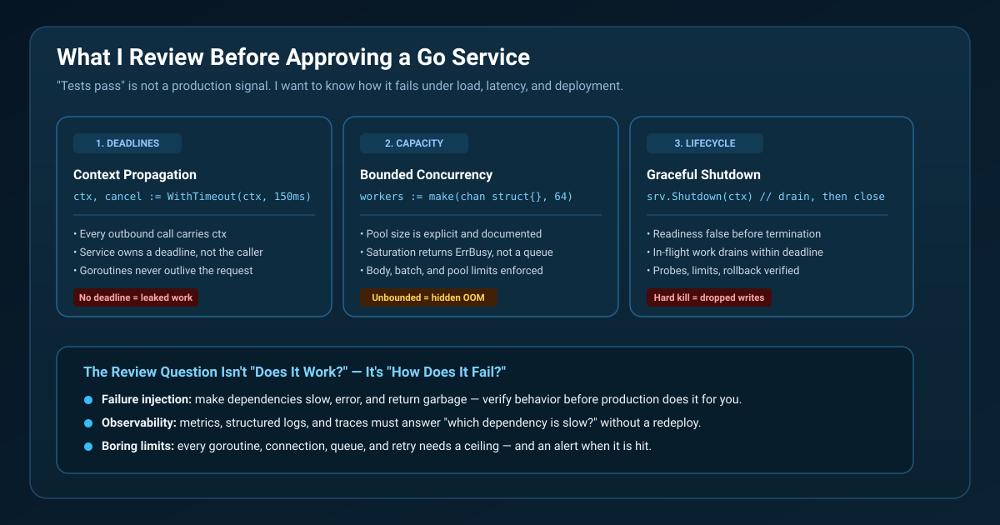

# What I review before approving a Go service for production



For a Go service, "the tests pass" is not a production-readiness signal. I want to know what happens when dependencies stall, traffic bursts, and a deployment asks the process to stop.

Three checks catch a large class of operational failures.

## 1. Deadline propagation

Every dependency call needs the request context and a service-owned deadline. Without one, a slow downstream system retains goroutines, sockets, and memory indefinitely — and the leak is invisible until the pod is killed.

```go
ctx, cancel := context.WithTimeout(ctx, 150*time.Millisecond)
defer cancel()
return s.dependency.Fetch(ctx, id)
```

The deadline must reach the dependency. A context that is created but never passed is decoration.

## 2. Bounded concurrency

Unlimited goroutines are not backpressure. A bounded pool fails fast when the service is saturated, which lets callers, load balancers, and autoscalers see pressure instead of hiding it in an ever-growing queue.

```go
workers := make(chan struct{}, 64)

select {
case workers <- struct{}{}:
    defer func() { <-workers }()
default:
    return ErrBusy
}
```

Returning `ErrBusy` is a feature. A fast rejection with a metric attached is easier to reason about than a request that silently waits 40 seconds for a slot.

## 3. Predictable shutdown

Once shutdown begins, stop accepting new work. Let in-flight work finish only within its deadline. Readiness should become false before termination so Kubernetes removes the pod from traffic.

```go
func (s *Service) Shutdown() {
    s.once.Do(func() { close(s.stopping) })
}
```

A hard kill drops writes that were already accepted. Draining within a deadline converts an outage into a controlled, observable event.

## What else I check

- Error handling with context and classification, not the same error logged at every layer
- Connection pool, request body, and queue size limits under real load
- Readiness vs. liveness separation
- Resource requests and limits that match measured behavior
- Rollback path and configuration validation at startup
- Metrics, structured logs, and traces that answer "which dependency is slow?"

## Hands-on demonstration

The repository includes a test suite that simulates a dependency that never returns. It verifies cancellation reaches the dependency, a second request gets `ErrBusy` instead of queueing forever, and shutdown rejects new work.

```bash
cd 04-go-production-readiness
go test ./...
```

Source: https://github.com/ArpitUS/linkedin-engineering-demos/tree/master/04-go-production-readiness

Practical takeaway: every goroutine, dependency call, and work queue must have a limit, a cancellation path, and a metric that exposes when the limit is reached.
