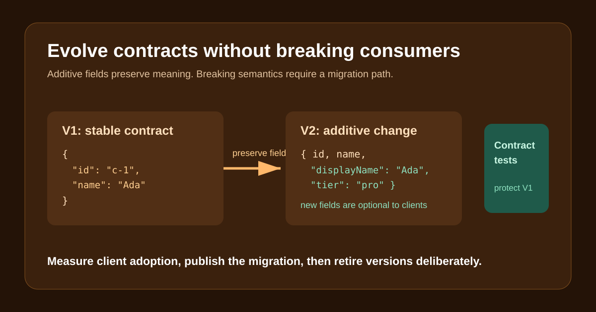

# Versioned APIs: how to evolve contracts without breaking downstream systems



Changing a public API is not a refactor. Existing consumers are part of the system being changed.

The safest evolution is additive. Add a field, preserve the old fields and their meaning, and make consumers tolerant of fields they do not understand. Incompatible changes, such as renaming a field or changing pagination semantics, require a new version and a migration plan.

In the demo, V1 returns:

```json
{"id":"c-1","name":"Ada Lovelace"}
```

V2 adds `displayName` and `tier` while preserving `id` and `name`. The V1 contract test stays in the repository to prevent a future implementation from accidentally leaking V2-only semantics into the stable contract.

Versioning is not permission to ignore adoption. Before removing a version, publish the deadline, document the migration, measure active client versions, and contact any remaining important consumers. A route named `/v2` does not make an unplanned breaking change safe.

Run the demonstration:

```text
cd 05-versioned-api-contracts
```

Source: https://github.com/ArpitUS/linkedin-engineering-demos/tree/master/05-versioned-api-contracts

Practical takeaway: protect every public version with a consumer-visible contract test, and use observed client adoption rather than an arbitrary date to decide when retirement is safe.
