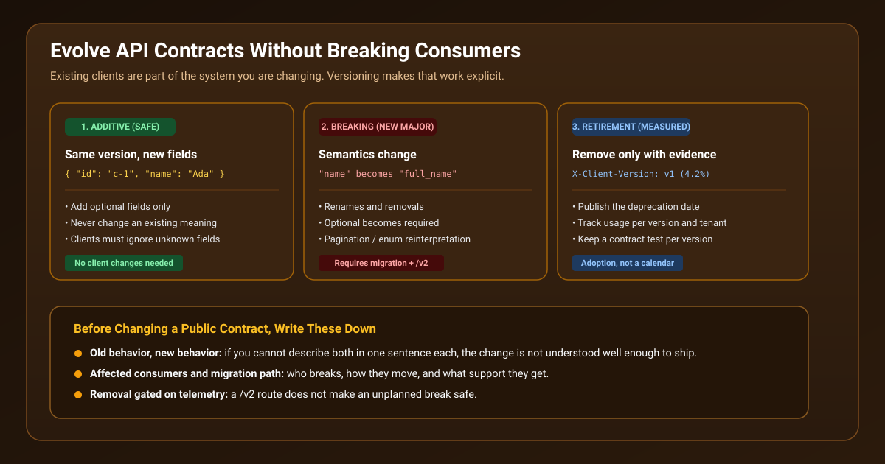

# Versioned APIs: how to evolve contracts without breaking downstream systems



API versioning is not primarily about adding `/v2` to a URL.

It is about treating existing consumers as part of the system you are changing.

## Breaking changes are rarely obvious

Most outages caused by API changes do not come from a dramatic rewrite. They come from small semantic shifts:

- Renaming a field
- Changing a field from optional to required
- Altering a default value
- Reordering assumptions in a response
- Changing pagination semantics
- Reinterpreting an existing enum value

Each one looks harmless in a pull request and each one can break a client silently.

## Evolve additively first

The safest change is one that adds without redefining:

```json
// V1 - and still V1 after the change
{ "id": "c-1", "name": "Ada Lovelace" }

// Additive: same version, new optional fields
{ "id": "c-1", "name": "Ada Lovelace", "displayName": "Ada", "tier": "pro" }
```

Rules that make this work:

- Add fields rather than replacing them
- Keep existing defaults stable
- Make consumers tolerant of unknown fields and values
- Introduce new enum values carefully, and document how old clients behave

A new major version is appropriate when the contract must change incompatibly. Versioning does not remove migration work — it makes that work explicit and manageable.

## Retirement is a measured decision

A `/v2` route does not make removal safe. Before retiring a version:

- Publish the deprecation date and migration guide
- Measure which clients still call the old version, by tenant where possible
- Keep a contract test per version so no one accidentally "cleans up" V1
- Contact remaining important consumers before the cutoff

The strongest API teams maintain compatibility as long as practical, publish clear deprecation paths, and use real client telemetry to decide when an old version can retire.

## Hands-on demonstration

The demo serves both versions and includes a contract test that fails if V1 changes.

```bash
cd 05-versioned-api-contracts
go test ./...
go run .
```

Output:

```text
/v1/customers/c-1 -> map[id:c-1 name:Ada Lovelace]
/v2/customers/c-1 -> map[displayName:Ada id:c-1 name:Ada Lovelace tier:pro]
```

Source: https://github.com/ArpitUS/linkedin-engineering-demos/tree/master/05-versioned-api-contracts

Practical takeaway: before changing a public contract, write down the old behavior, the new behavior, affected consumers, the migration path, and the removal date — then enforce the old version with a test.
